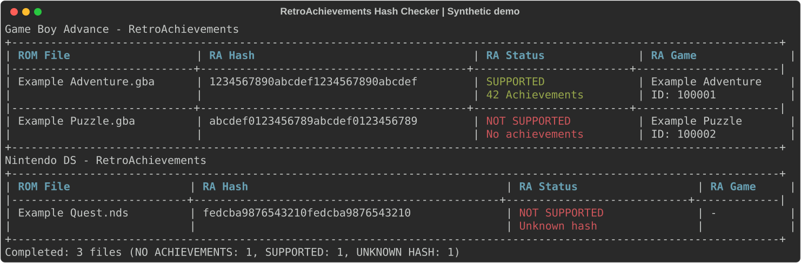

# RetroAchievements Hash Checker

Identify ROMs and disc images using the hashes RetroAchievements actually uses.


A read-only command-line tool that calculates official RA hashes, looks up matching
games, and reports achievement support. Built around a pinned copy of
[rcheevos](https://github.com/RetroAchievements/rcheevos), not a generic whole-file
MD5 calculation.

- **50 console groups** from Nintendo, Sega, Sony, Atari, and more.
- **Multiple search folders**, including external drives and network shares.
- **One terminal table per console**, plus plain-text and structured JSON reports.
- **Safe by design:** no ROM modification, conversion, archive extraction, or guessed console matches.

ROM files and API credentials are not included. Use files you are authorized to access.

[Terminal Preview](#terminal-preview) | [Quick Start](#quick-start) | [Usage](#usage) | [Configuration](#configuration) |
[Supported Systems](#supported-systems-and-formats) | [Troubleshooting](#troubleshooting) |
[Development](#development)

## Terminal Preview



Rendered by the application using **synthetic example data**, not real ROMs or
catalog matches. No API key or personal paths are included.

See [Terminal Examples](docs/examples.md) for copyable console output, the compact
view for narrow terminals, and instructions to regenerate the previews.

## Quick Start

### Requirements

| Component | Requirement |
| --- | --- |
| Python | 3.11 or newer |
| Build system | CMake and a C compiler |
| Windows toolchain | Visual Studio Build Tools: **Desktop development with C++**, including a Windows SDK |
| Linux toolchain | GCC or Clang, Python development headers, and CMake |
| Online lookup | A personal RetroAchievements Web API key |

For example, Debian/Ubuntu build dependencies are `build-essential python3-dev cmake`.
No prebuilt wheels are published yet. A matching, already-built wheel does not
require a compiler at runtime.

### 1. Install From the Repository Root

**Windows / PowerShell** (with Python 3.11+ installed):

```powershell
py -3 -m venv .venv
.\.venv\Scripts\python.exe -m pip install -e .
if (-not (Test-Path .env)) { Copy-Item .env.example .env }
```

**Linux:**

```bash
python3 -m venv .venv
.venv/bin/python -m pip install -e .
test -f .env || cp .env.example .env
```

### 2. Configure Your Library

Set your personal **Web API key** from your
[RetroAchievements settings](https://retroachievements.org/settings) in `.env`,
then add the folders to search. Paths are a JSON list:

```dotenv
RA_API_KEY=your_web_api_key
RA_ROM_PATHS=["roms", "D:/Games/ROMs"]
RA_LOG_ENABLED=true
RA_LOG_DIR=log
RA_CACHE_DIR=cache
```

Replace the example drive with your own folder. Forward slashes also work on
Windows; JSON backslashes must be doubled, for example `"D:\\Games\\ROMs"`.
The tracked [.env.example](.env.example) contains safe defaults without credentials.

### 3. Run a Check

```powershell
.\.venv\Scripts\python.exe -m ra_hash_checker
```

On Linux, use `.venv/bin/python -m ra_hash_checker` instead. With the virtual
environment activated, the shorter `ra-hash-checker` command is also available.

By default, the tool searches recursively for all configured consoles. Shared
extensions such as `.iso` need an explicit console filter; see [Usage](#usage).

## Usage

```bash
# Check Nintendo DS and Game Boy Advance ROMs in several locations
ra-hash-checker --paths "D:/ROMs" "E:/More ROMs" --consoles ds gba

# Assign ISO images explicitly to PlayStation 2
ra-hash-checker --paths "D:/ROMs/ps2" --consoles ps2

# Check DS and PS2 together when those are the only matching systems
ra-hash-checker --consoles ds ps2

# Arcade archives are identified by filename, not extracted contents
ra-hash-checker --paths "D:/Arcade" --consoles arcade

# Use fresh cached catalogs without network requests or report files
ra-hash-checker --offline --no-log

# Discover console names, formats, and aliases
ra-hash-checker --list-consoles
ra-hash-checker --help
```

`--consoles ps2 psp` still leaves `.iso` ambiguous. A folder called `ps2` does
**not** assign a console automatically. Use a single matching console per shared
extension, or check those console folders in separate runs.

### Command Reference

| Option | Purpose |
| --- | --- |
| `--paths PATH [PATH ...]` | Search folders recursively; replaces configured paths; repeatable |
| `--consoles NAME [NAME ...]` | Restrict console candidates by name or alias; repeatable; default: `all` |
| `--api-key KEY` | Override the API key; prefer `.env` to avoid shell-history exposure |
| `--log` / `--no-log` | Enable or disable **both** text and JSON reports; default: enabled |
| `--log-path PATH` | Report directory; default: `log` |
| `--cache-dir PATH` | Catalog directory; default: `cache` |
| `--offline` | Use only fresh, valid cached catalogs; never contact the API |
| `--refresh-cache` | Fetch fresh catalogs instead of using cached ones |
| `--project-dir PATH` | Base for default directories and automatic `.env` lookup |
| `--env-file FILE` | Read a specific configuration file; it must exist |
| `--list-consoles` | List supported names, aliases, and extensions, then exit |
| `--help` | Show command-line help |

`all` cannot be combined with individual consoles. `--offline` and
`--refresh-cache` are mutually exclusive. `--log-path` does not re-enable disabled
logging. Help and console listing make no API requests and create no report files.

## Configuration

**Precedence:** command line > process environment > `.env` > defaults.

| Variable | Default | Description |
| --- | --- | --- |
| `RA_API_KEY` | Empty | Personal RetroAchievements Web API key |
| `RA_ROM_PATHS` | `["roms"]` | Non-empty JSON list of search folders |
| `RA_LOG_ENABLED` | `true` | Write text and JSON reports |
| `RA_LOG_DIR` | `log` | Report output directory |
| `RA_CACHE_DIR` | `cache` | Per-console catalog cache directory |

`RA_ROM_PATHS` is not a colon-separated path string; Windows drive letters are
preserved. Relative CLI and process-environment paths use the working directory.
Relative `.env` paths use the directory containing that file.

In a source/editable checkout, defaults use the project root. An installed wheel
uses the current working directory, never `site-packages`. Override that base with
`--project-dir`. `.env` is optional unless selected explicitly with `--env-file`.
The application does not overwrite your process environment.

## Results and Reports

Each detected console gets its own table with **ROM File**, **RA Hash**,
**RA Status**, and **RA Game** columns. Matched game titles link to RetroAchievements.
Small terminals use a compact list instead; hashes stay complete at 32 columns or wider.

| JSON status | Meaning |
| --- | --- |
| `SUPPORTED` | Known hash with achievements available |
| `NO_ACHIEVEMENTS` | Known game without achievements |
| `UNKNOWN_HASH` | Valid calculated hash not found in the catalog |
| `UNCHECKED` | Hash calculated, but no usable catalog was available |
| `HASH_ERROR` | File, format, or disc structure could not be hashed |
| `FORMAT_UNSUPPORTED` | Recognized container/format unsupported by this build |
| `AMBIGUOUS_CONSOLE` | Multiple selected consoles accept this extension |
| `SCAN_ERROR` | A search path could not be accessed |

An unknown hash does **not** prove a ROM is invalid. The catalog may not contain
that region, revision, or patched version.

Reports are enabled by default:

```text
log/run-<UTC timestamp>-<unique suffix>.log
log/run-<UTC timestamp>-<unique suffix>.json
```

The text report contains the same tables and summary without ANSI/OSC escapes.
JSON includes tool/engine versions, safe options, timestamps, file paths, hashes,
statuses, game URLs, alternative matches, cache provenance, and totals. API keys
are excluded, but reports still contain local paths and game names; review them
before sharing. `--no-log` disables reports, not the terminal display or catalog cache.

For duplicate hash matches, the highest achievement count wins, then the lowest
game ID. JSON retains every alternative. Ctrl-C preserves completed work in a
partial report marked as aborted.

| Exit code | Meaning |
| --- | --- |
| `0` | Complete, including unknown hashes, games without achievements, or no matching files |
| `1` | Incomplete check: scan, format, assignment, API/cache, or report warning/error |
| `2` | Invalid arguments/configuration or missing native engine |
| `130` | Interrupted by the user |

## Supported Systems and Formats

Extensions identify **candidates**, not guaranteed-compatible content. The native
engine validates the file structure. Ambiguous extensions are never resolved by
trying hashes or searching for an API match.

<!-- markdownlint-disable MD033 -->

<details>
<summary><strong>View all 50 console groups and input formats</strong></summary>

Hash/API IDs follow the upstream console definitions. FDS ID 81 must also be
confirmed by the server before an online catalog lookup.

| Console group | Hash/API ID | Input extensions |
| --- | --- | --- |
| 3DO | 43 | cue, iso, bin |
| Amstrad CPC | 37 | dsk |
| Apple II | 38 | dsk, do, po, nib |
| Arcade | 27 | zip, 7z; explicit Arcade selection only |
| Arduboy | 71 | hex |
| Atari 2600 | 25 | a26, bin |
| Atari 7800 | 51 | a78, bin |
| Atari Jaguar | 17 | j64, jag, rom, abs, cof, bin |
| Atari Jaguar CD | 77 | cue; session-aware descriptor required |
| Atari Lynx | 13 | lnx |
| WonderSwan | 53 | ws |
| WonderSwan Color | 53 | wsc |
| ColecoVision | 44 | col, rom, bin |
| Channel F | 57 | chf, bin |
| Vectrex | 46 | vec, bin |
| Odyssey2 | 23 | o2, bin |
| Intellivision | 45 | int, rom, bin |
| MSX / MSX2 | 29 | rom, mx1, mx2, dsk, cas |
| PC-8001 / PC-8801 | 47 | d88, d98, dsk, 88d |
| PC Engine / TurboGrafx-16 / SuperGrafx | 8 | pce, sgx |
| PC Engine CD / TurboGrafx-CD | 76 | cue, iso, bin |
| PC-FX | 49 | cue, iso, bin |
| Famicom Disk System | 81 | fds |
| Game Boy | 4 | gb |
| Game Boy Advance | 5 | gba |
| Game Boy Color | 6 | gbc |
| GameCube | 16 | iso, gcm |
| Nintendo 64 | 2 | z64, v64, n64 |
| Nintendo DS | 18 | nds |
| NES / Famicom | 7 | nes |
| Pokemon Mini | 24 | min |
| SNES / Super Famicom / Satellaview / Sufami Turbo | 3 | sfc, smc, swc, bs, st |
| Virtual Boy | 28 | vb, vboy |
| Neo Geo CD | 56 | cue, iso, bin |
| Neo Geo Pocket | 14 | ngp |
| Neo Geo Pocket Color | 14 | ngc |
| Sega 32X | 10 | 32x, bin |
| Dreamcast | 40 | gdi, cue, bin |
| Game Gear | 15 | gg |
| Master System | 11 | sms |
| Mega Drive / Genesis | 1 | md, gen, bin |
| SG-1000 | 33 | sg |
| Saturn | 39 | cue, iso, bin |
| Sega CD | 9 | cue, iso, bin |
| PlayStation | 12 | cue, iso, bin, exe (PS-X EXE; never executed) |
| PlayStation 2 | 21 | iso, cue, bin |
| PSP | 41 | iso |
| WASM-4 | 72 | wasm |
| Supervision | 63 | sv |
| Mega Duck | 69 | duck, bin |

</details>

<!-- markdownlint-enable MD033 -->

### Disc Images and Archives

The bundled reader handles CUE/GDI/raw images with 2048-, 2336-, and 2352-byte
sectors. Support depends on the console and disc structure, not just the filename.
Referenced tracks must exist. Tracks referenced by a CUE/GDI descriptor are not
listed again as separate games. Each disc remains a separate entry.

**Not supported by this build:** CHD, CSO/CISO, RVZ, WBFS, GCZ, NKit-ISO, PBP,
CCD, M3U, SMD, UNIF, and Arduboy package archives. Recognized unsupported formats
are reported as `FORMAT_UNSUPPORTED`, never hashed with a fallback whole-file MD5.
CHD means *Compressed Hunks of Data*, a compressed disc/storage-image container;
the bundled reader cannot decode it.

Regular ZIP/7z ROM archives are not extracted. Explicit Arcade mode hashes the
case-sensitive archive name. Special FBNeo subsystem directories such as `nes/`
also affect that hash.

Directory symlinks are not followed. Overlapping paths and identical resolved
files are deduplicated; independent copies are not. 3DS, Wii, PS3, and a separate
DSi adapter are outside the current scope.

## API and Cache

- Catalogs use `API_GetGameList.php` with `i=<console>`, `h=1`, and `f=0`.
- Only required catalogs are requested. Shared console IDs are loaded once per run.
- Cache validity is **24 hours**. Invalid, stale, and future-dated entries are rejected.
- Offline mode never silently matches against an expired catalog.
- Requests time out after 30 seconds; HTTP 429 allows at most two retries.
- Retries require `Retry-After` of at most 5 seconds; authentication failures are not retried.
- A cache-write failure does not discard a valid downloaded catalog.

A fresh, valid legacy DS cache can be copied into the new schema without changing
its original file or fetch age. The [hashing reference](Game%20Identification.md)
is retained for context; the pinned upstream implementation is authoritative.
Notable details include DS icon padding/SuperCard headers, N64 byte order,
256 Dreamcast metadata bytes, PSP `PARAM.SFO`, and upstream's 64 MiB limit on many hashes.

## Troubleshooting

### External ROMs Are Missing

Check that the folder is accessible to the same user running the tool and that
`RA_ROM_PATHS` is valid JSON. Mapped Windows drives may appear as UNC network paths;
that is normal. Subfolders are searched recursively.

An existing environment variable overrides `.env`. Some VS Code terminals inherit
older values when `.env` integration is enabled. In the affected PowerShell terminal:

```powershell
Remove-Item Env:RA_ROM_PATHS -ErrorAction SilentlyContinue
.\.venv\Scripts\python.exe -m ra_hash_checker
```

Alternatively, use `--paths` to override both sources explicitly.

### ISO Files Say AMBIGUOUS CONSOLE

Use `--paths "D:/ROMs/ps2" --consoles ps2`. The tool does not infer a console from
folder names and will not try candidate hashes to guess one.

### Hashes Say NOT CHECKED

Configure a Web API key or provide a fresh catalog cache. Hashing itself does not
require a key. `--offline` intentionally prevents downloading missing catalogs.

### The Native Engine Is Missing

Install the required compiler and CMake, then rerun the editable installation
command from [Quick Start](#quick-start). Merely running the source files does not
compile the extension. The old `nds_hash.py` entry point has been replaced by
`python -m ra_hash_checker`.

## Development

Activate your virtual environment, then install the development dependencies:

```bash
python -m pip install -e ".[dev]"
python -m pytest -q
cmake -S . -B cache/native-tests -DRA_BUILD_TESTS=ON
cmake --build cache/native-tests --config Release
ctest --test-dir cache/native-tests -C Release --output-on-failure
python -m build
```

The [CI workflow](.github/workflows/test.yml) targets Windows and Linux with Python
3.11 and 3.14, runs Python and upstream synthetic ROM/disc tests, and smoke-tests
an installed wheel outside the checkout. Local validation does not substitute for
running each CI platform.

To verify or update the vendored engine, use
`python scripts/vendor_rcheevos.py --check` or
`python scripts/vendor_rcheevos.py --update FULL_COMMIT_SHA`.
These maintenance commands require GitHub access. See the
[vendor notes](src/ra_hash_checker/_vendor/README.md#checking-and-updating) for
safety checks, exit codes, and the required validation after an update.

Application modules live under `src/ra_hash_checker/`:

| Component | Responsibility |
| --- | --- |
| `consoles/` | One adapter per console group |
| `native/` | Python C bridge |
| `_vendor/` | Pinned official engine and unchanged upstream license |
| `api.py` | RetroAchievements HTTP client |
| `cache.py` | Validated per-console catalogs |
| `config.py` | CLI and environment configuration |
| `scanner.py` | Discovery and console assignment |
| `runner.py` | Hashing and lookup pipeline |
| `tables.py` | Rich tables |
| `output.py` | Terminal and plain-text rendering |
| `reports.py` | Text and JSON report files |

### Contributing

Bug reports should include your OS, Python version, console, file extension,
command, and relevant error text. Remove API keys and private paths first.
Use synthetic fixtures for tests. Do not submit ROMs, personal caches, credentials,
or unredacted logs. Keep changes focused and run the relevant checks above.

### Upstream Acknowledgments

Hashing is powered by the official RetroAchievements rcheevos project. The pinned
commit, build features, and source provenance are documented in the
[vendor notes](src/ra_hash_checker/_vendor/README.md). Its
[upstream license](src/ra_hash_checker/_vendor/rcheevos/LICENSE) is preserved unchanged.
