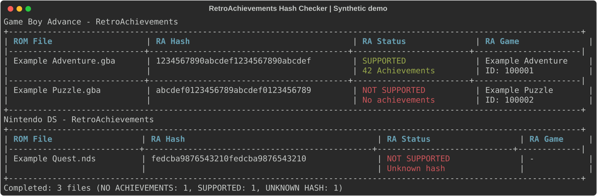

# Terminal Examples

[Back to the README](../README.md#terminal-preview)

These previews use the application's actual terminal renderer with **synthetic
data**. Filenames, hashes, game IDs, titles, and achievement counts are illustrative,
not real catalog entries or scan results. No ROMs, API key, personal paths, or
network access are needed to generate them.

## Standard Terminal

Each console has its own table. This 120-column example shows a supported game,
a known game without achievements, and an unknown hash.



Copyable plain-text output (120 columns):

```text
                                          Game Boy Advance - RetroAchievements                                          
+----------------------------------------------------------------------------------------------------------------------+
| ROM File                   | RA Hash                                 | RA Status              | RA Game              |
|----------------------------+-----------------------------------------+------------------------+----------------------|
| Example Adventure.gba      | 1234567890abcdef1234567890abcdef        | SUPPORTED              | Example Adventure    |
|                            |                                         | 42 Achievements        | ID: 100001           |
|----------------------------+-----------------------------------------+------------------------+----------------------|
| Example Puzzle.gba         | abcdef0123456789abcdef0123456789        | NOT SUPPORTED          | Example Puzzle       |
|                            |                                         | No achievements        | ID: 100002           |
+----------------------------------------------------------------------------------------------------------------------+
                                            Nintendo DS - RetroAchievements                                             
+----------------------------------------------------------------------------------------------------------------------+
| ROM File                  | RA Hash                                       | RA Status                  | RA Game     |
|---------------------------+-----------------------------------------------+----------------------------+-------------|
| Example Quest.nds         | fedcba9876543210fedcba9876543210              | NOT SUPPORTED              | -           |
|                           |                                               | Unknown hash               |             |
+----------------------------------------------------------------------------------------------------------------------+
Completed: 3 files (NO_ACHIEVEMENTS: 1, SUPPORTED: 1, UNKNOWN_HASH: 1)
```

`SUPPORTED` includes the achievement count. Both a known game without achievements
and an unknown hash display `NOT SUPPORTED`, with a different explanation below.
An unknown hash does not mean the ROM is invalid.

## Narrow Terminal

Below 80 columns, the same results become a compact list. This 54-column example
keeps every 32-character hash intact:

```text
Game Boy Advance - RetroAchievements
Example Adventure.gba
1234567890abcdef1234567890abcdef
SUPPORTED
42 Achievements
Example Adventure
ID: 100001

Example Puzzle.gba
abcdef0123456789abcdef0123456789
NOT SUPPORTED
No achievements
Example Puzzle
ID: 100002

Nintendo DS - RetroAchievements
Example Quest.nds
fedcba9876543210fedcba9876543210
NOT SUPPORTED
Unknown hash
-

Completed: 3 files (NO_ACHIEVEMENTS: 1, SUPPORTED: 1, 
UNKNOWN_HASH: 1)
```

The summary counts refer to the JSON status names. These three example statuses
all allow exit code `0`; errors and incomplete checks are documented in
[Results and Reports](../README.md#results-and-reports).

## Try It on Your Library

After [installation and configuration](../README.md#quick-start), run:

```bash
ra-hash-checker --paths "roms" --consoles gba ds
```

This command scans your own files; it does not recreate the synthetic results above.
By default, it also writes plain-text and JSON reports into `log/`.

## Regenerate the Previews

From the repository root, with the project installed and its virtual environment
activated:

```bash
python docs/render_examples.py
python docs/render_examples.py --check
```

The generator calls `print_report` and `render_text` from the application. It only
writes this page and the SVG preview, never reads `.env`, and never scans ROM folders
or contacts RetroAchievements. The SVG is a vector terminal capture, not a desktop
screenshot. Changes to the renderer or the installed Rich version can change it.
